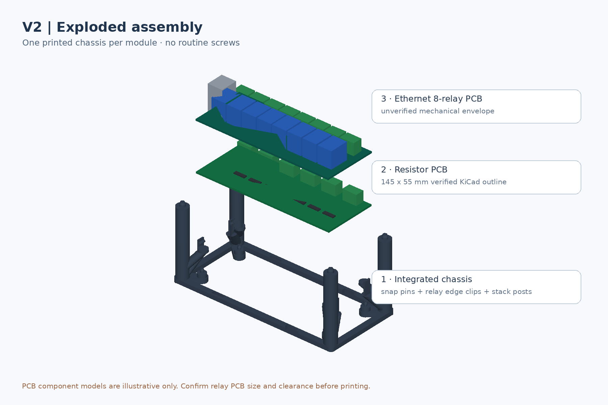
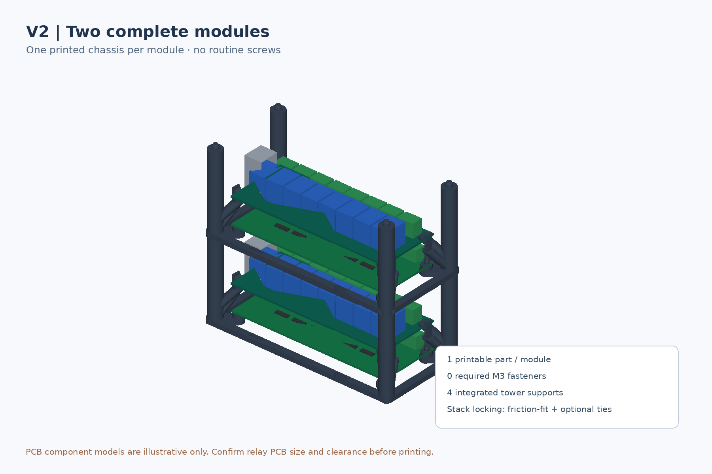

# Enclosure V2 — Single-piece stackable open frame

**Prototype only: CAD validated, hardware fit not verified.** V2 replaces the **14 separate printed items of V1** (base, tray, four adjustable arms, four lower posts, four upper stack posts) with a **single monolithic 3D-printed chassis per module**. The bottom resistor PCB and upper eight-relay Ethernet PCB are retained by integral printed clips rather than routine M3 screws. Four printed posts support stacking.

## Verified data versus assumptions

The resistor PCB dimensions were extracted from the real [KiCad board](../../Resistors-board/Resistors-board.kicad_pcb): **145 × 55 × 1.6 mm**, **4 × 3.2 mm holes**, **138 × 48 mm** hole pitch, each corner hole 3.5 mm from its corresponding PCB edges.

The YHQ001/CH9120 relay board **does not have a dimensioned mechanical CAD drawing in this repository**. V2's upper relay board **145 × 56 mm** is an **UNVERIFIED placeholder**. The rendered blue relay blocks, RJ45 body and other electronics are illustrative. Do **not** force an actual relay board into incompatible clips; change \`U_X\`, \`U_Y\` and the clip locations first.

## V2 design

| Parameter | Value | Qualification |
|---|---:|---|
| Printed parts per complete module | **1** | Verified in CAD |
| Routine screws, inserts or separate spacers | **0** | Design intent, snap joints need real-world tests |
| Printed chassis base XY | **174 × 82 mm** | Verified |
| Total height including locating pegs | **78 mm** | Verified |
| Base rail thickness | 4.4 mm | Verified |
| Bottom resistor PCB underside | Z = 8.0 mm | Verified |
| Bottom resistor PCB top surface | Z = 9.6 mm | Verified |
| Upper relay PCB underside | Z = 32.0 mm | Parametric design assumption |
| Nominal clear distance above resistor components | **8.4 mm** | Only if lower components are at most 14 mm high |
| Vertical module-to-module base pitch | **74 mm** | Verified |
| Nominal free headroom above relay components | **13.4 mm** | Only if upper components are at most 27 mm high |
| Male stacking peg / female socket diameter | Ø5.15 / Ø5.60 mm | Clearance-fit for alignment, **not a positive latch** |

The requested **5–10 mm separation is calculated between the highest resistor component and the underside of the relay PCB**, not the unpopulated board surfaces. Adjust for the *actual component heights*:

\`\`\`text
resistor-to-relay free gap = 32.0 - (8.0 + 1.6 + actual resistor component height)
relay-to-next-base headroom = 74.0 - (32.0 + 1.6 + actual relay component height)
\`\`\`

## Screwless assembly

1. Print the **single \`chassis_v2.stl\`** with its bottom frame resting on the FDM bed, four towers pointing upward.
2. Remove brim and deburr four integral lower split-snap pins and four relay edge clips. Test gently with scrap PCB/coupon first.
3. Press the resistor PCB **only near its four mounting holes** onto the four Ø2.6-mm split pins, which have tapered Ø3.5-mm retaining heads designed for 3.2-mm holes.
4. Route and connect lower terminal wiring before installing the upper PCB. Avoid trapping screw-terminal access or wires.
5. After measuring the relay PCB outline, confirm the CAD parameters fit. Seat the upper PCB on its four integrated gusseted supports and retain its end edges under four integral cantilever clips.
6. To stack, lower the second complete assembly onto the four integrated locating pegs. The sockets **provide alignment only**, not retention against pulling apart. Use a suitably restrained rack, or additional correctly routed cable ties for secure transport or vertical mounting.

**Mechanical risks:** printed clips may snap or cause PCB bending; wires and solder tails may clash. Start with an inexpensive coupon and trial print. Do not operate exposed boards at unsafe voltages. Preserve thermal airflow and required electrical creepage/clearance; PETG is not automatically a rated electrical insulator.

## 3D-printing requirements

- Recommended first material **PETG** for resilient printed clips (PLA is less suitable for repeated flexing).
- A 220 × 220 mm print bed fits the 174 × 82 mm chassis plus a brim.
- Example initial slicer: 0.4-mm nozzle, 0.2-mm layers, at least 4 perimeters, 30–40% infill, **5–8 mm brim** for tall narrow columns.
- One-piece body is designed upright with continuously sloping gussets. No large unsupported horizontal tray or roof bridges; **supports are not normally expected**, but **inspect the clip lips and socket geometry in the slicer**.
- Test calibrated hole/peg clearances; CAD is dimensioned nominally, but extrusion widths, shrinkage, layer adhesion and clip durability vary by printer.

## Source, FreeCAD and exports

- [\`create_v2.py\`](create_v2.py) — editable CadQuery source, clearance and board-size parameters.
- [\`chassis_v2.stl\`](chassis_v2.stl) — **one printable STL**.
- [\`chassis_v2.step\`](chassis_v2.step) — open as STEP in FreeCAD.
- [\`module_reference.step\`](module_reference.step) — frame with both reference PCB outlines.
- [\`two_modules_reference.step\`](two_modules_reference.step) — two-module stack reference.
- [\`exploded_reference.step\`](exploded_reference.step) — CAD exploded assembly.
- [\`assembled_v2.png\`](assembled_v2.png), [\`exploded_v2.png\`](exploded_v2.png), [\`stacked_v2.png\`](stacked_v2.png) — renderings based on generated CAD and schematic component models.
- [\`render_cpu.py\`](render_cpu.py) — CPU-only visualization generator.
- [\`verification.json\`](verification.json) — exact generated solid and mesh report.

Locally regenerate with:

\`\`\`bash
python -m pip install cadquery trimesh numpy pillow
python enclosure/V2/create_v2.py
python enclosure/V2/test_fit.py
python enclosure/V2/render_cpu.py
\`\`\`

## Fit/qualification checklist

- [x] Derived lower PCB size and mounting-hole centres from KiCad.
- [x] Single-component V2 frame generated as an editable solid.
- [x] Local BRep validity, single-solid and watertight STL verified.
- [x] Nominal 8.4 mm vertical clearance with 14 mm placeholder lower components.
- [x] Two-module and exploded arrangement STEP references.
- [ ] Actual Ethernet relay board **width, length, thickness and edge component positions** measured.
- [ ] Actual **lower resistor PCB highest component** measured.
- [ ] Actual relay PCB component height, RJ45/cable and terminal block access measured.
- [ ] PETG snap coupon with real 3.2 mm lower PCB holes, torque and flex tested.
- [ ] Physical fit test and stack pull-out / sway / thermal checks performed.

**Limitations:** one printed part is easier to assemble but a broken clip requires reprinting the whole frame. Compared to V1, upper PCB mounting is no longer adjustable after printing; change the source and re-export for variants.
