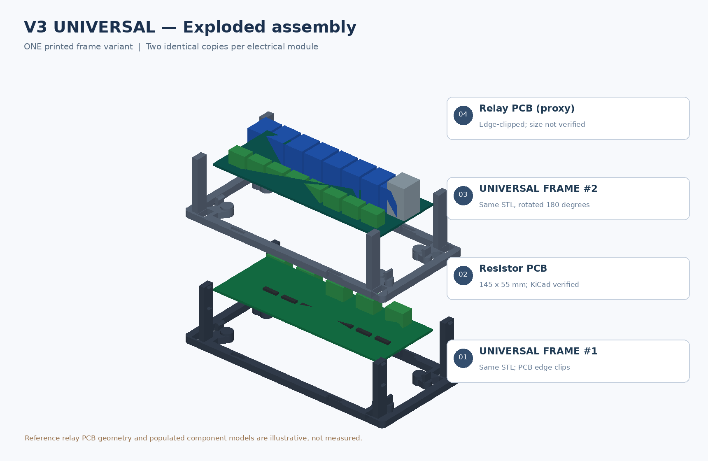
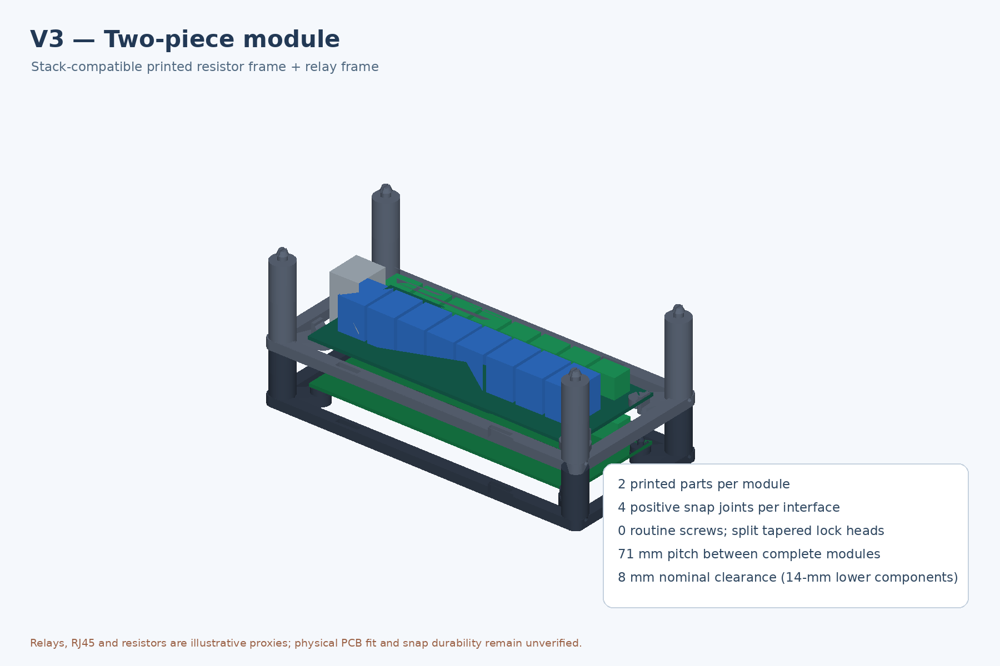
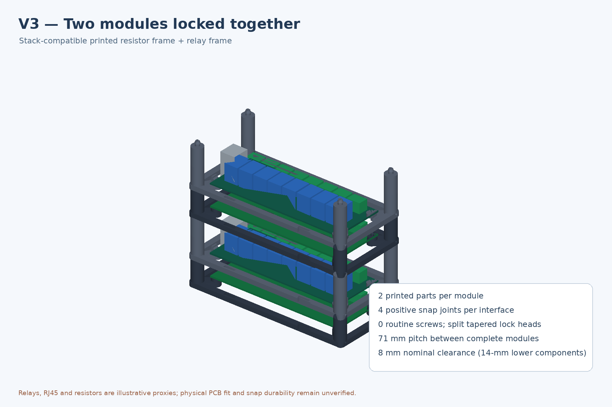

# Enclosure V3 — two printed, screwless and stackable frames

**Status: CAD-qualified prototype; mechanical fit and strength NOT verified on physical hardware.**

V3 replaces the large monolithic V2 enclosure with **exactly two 3D-printed parts per module**:

1. **resistor_frame.stl** — lower 28-mm-pitch open frame with four integrated split pins that engage the *verified* resistor PCB holes.
2. **relay_frame.stl** — upper 43-mm-pitch open frame with four integrated relay PCB edge clips and mounting seats.

**Every frame is independently stackable using the SAME corner joint:** four slotted/tapered male snap heads on the top of its posts and four female shoulder sockets on its underside. The relay frame snaps onto the resistor frame; the next resistor frame snaps onto the relay frame. No separate posts, screw bosses, latching clips or routine fasteners. Side ports allow tool-assisted unlocking for service.

## Verified geometry and assumptions

The lower resistor PCB's [actual KiCad layout](../../Resistors-board/Resistors-board.kicad_pcb) is **145 × 55 × 1.6 mm**, with **four Ø3.2-mm holes on a 138 × 48 mm pitch** (3.5 mm from each corner).

**NOT verified:** actual YHQ001 / CH9120 eight-channel Ethernet relay PCB dimensions, terminal positions, loaded component heights and cable access. The modeled upper PCB **145 × 56 mm** and all component shapes in visualizations are illustrative mechanical placeholders. Do not force the relay board into the prototype's edge clips until its real footprint is measured.

| Parameter | V3 nominal |
|---|---:|
| Printed parts per complete module | **2** |
| Routine screws / insert nuts | **0** |
| Frame footprint | **174 × 82 mm** |
| Lower frame height to mounting plane | **28 mm** |
| Upper frame height to next module | **43 mm** |
| Full module stacking pitch | **71 mm** |
| Shorter printed part max height (including male peg) | **33.1 mm** |
| Taller printed part max height (including male peg) | **48.1 mm** |
| Lower PCB underside | Z = 8.0 mm |
| Upper relay PCB underside | Z = 31.6 mm |
| Nominal free clearance over 14-mm-tall lower components | **8.0 mm** |
| Nominal headroom over 27-mm-tall upper components | **10.8 mm** |
| Locked joints between any two frames | Four integrated snap connections |

The requested 5–10 mm is the **free vertical gap over the highest lower-board component**, not PCB-to-PCB spacing. Recalculate when measuring the populated PCBs:

- Free resistor–relay clearance = \`31.6 − (8.0 + 1.6 + actual_lower_component_height)\`
- Free relay-to-next-module clearance = \`43.0 − (3.6 + 1.6 + actual_upper_component_height)\`

Adjust \`LOWER_PITCH\`, \`UPPER_PITCH\`, \`RES_SUPPORT_Z\`, \`RELAY_SUPPORT_Z\`, \`U_X\`, and \`U_Y\` in \`create_v3.py\` as needed; the mating stack joint stays identical.

## Snap locking system

All frame corners have an integral Ø12-mm post and:

- Male Ø4.20-mm shaft and tapered head, Ø5.35-mm maximum.
- Ø0.85-mm split slot, allowing two flexible halves of the peg.
- Female Ø4.75-mm entry and Ø6.00-mm enlarged counterbore.
- Approximate 0.30-mm required radial compression per snap finger during insertion; a *nominal geometry value*, not measured force.
- Opposing **Ø2.4-mm horizontal service ports** at each socket to compress the snap fingers with narrow tweezers for disassembly.

This provides a *positive geometrical latch*, unlike V2's unlatched locating pins. **Latch strength, assembly force, tolerance stack-up, repeated-cycle fatigue and vibration capacity are not physically qualified.** For transporting or suspending a stack, provide additional external restraint until tested.

## FDM printing and assembly

Use **PETG** for initial trials, 0.4-mm nozzle, 0.2-mm layer height, 4–5 perimeters, 30–40% infill. Both bases print flat with the columns upright. A 220 × 220 mm bed easily accommodates one frame plus a brim. A 5–8-mm brim can reduce lifting and tall-column sway. The design avoids long unsupported roof spans; inspect small clip overhangs and Ø2.4-mm release holes in the slicer before printing.

1. Print one lower and one upper frame per complete module, then clear the snap slots.
2. Seat resistor PCB using its four verified Ø3.2 mounting holes; push only near the holes.
3. Pre-wire the lower PCB screw terminals while access is open.
4. Confirm upper relay board envelope and connector orientation; gently seat in edge retainers.
5. Lower the relay frame straight onto the resistor frame. Apply pressure **to the four frame corners**, not onto the PCB, until all four latches engage.
6. Attach the next module's resistor frame to the upper relay frame using the same joint and repeat.
7. For disassembly, use appropriate narrow tools through the snap release ports and compress the fingers while lifting evenly.

Maintain required electrical insulation distances and airflow for the working circuit. Printed PETG does not make exposed live electronics a certified electrical enclosure.

## Models, drawings and tests

- [Editable CadQuery source](create_v3.py) — generates the complete CAD solids.
- [Lower resistor frame STL](resistor_frame.stl) / [STEP](resistor_frame.step).
- [Upper relay frame STL](relay_frame.stl) / [STEP](relay_frame.step).
- [Complete module STEP](module_assembly.step), [two stacked modules STEP](two_modules.step) and [exploded STEP](exploded_assembly.step).
- [Exploded view](exploded_v3.png), [assembled view](assembled_v3.png), [two-module view](stacked_v3.png).
- [CAD render source](render_v3.py), [nominal fit tests](test_fit.py).
- [Solid and mesh verification](verification.json), [collision verification](fit_check.json).

Generate or regenerate locally:

\`\`\`bash
python -m pip install cadquery trimesh numpy pillow
python enclosure/V3/create_v3.py
python enclosure/V3/test_fit.py
python enclosure/V3/render_v3.py
\`\`\`

## Qualification

- [x] Actual resistor PCB outline and mounting pitch used.
- [x] Two STEP/STL printed solids generated from editable source.
- [x] BRep validity, one-solid-per-part, and watertight STL mesh checks.
- [x] Nominal PCB and interframe CAD collisions checked in both stack directions.
- [x] V3 assembled, exploded, and stacked CAD renderings.
- [ ] Measure YHQ001 board outline, populated component heights, and cable clearance.
- [ ] Print and physically test split-snap and release-hole geometry, including retention forces and fatigue.
- [ ] Confirm terminal access, mechanical stability and safe maximum stack height.

**Do not treat CAD-only validation as a verified physical fit or structural load rating.**
