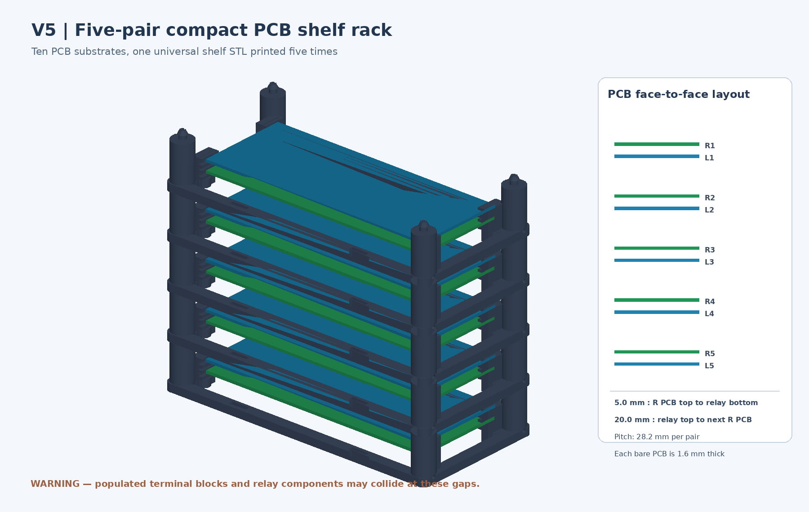
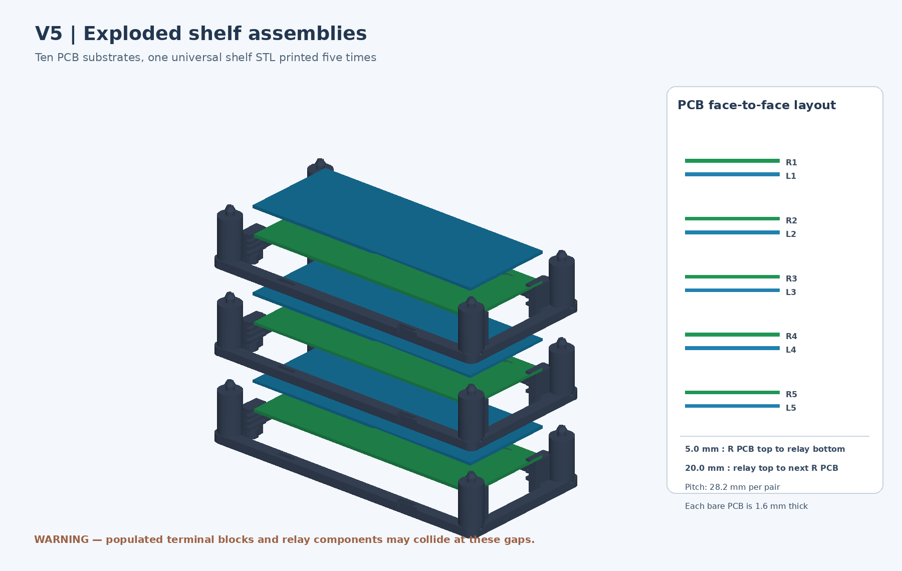

# Enclosure V5 — compact ten-PCB slide-in shelf rack

**Status: CAD prototype only — populated electronics fit is NOT verified.**

The frame supports five resistor and five eight-relay PCBs, alternating bottom-to-top:
R1, L1, R2, L2, R3, L3, R4, L4, R5, L5. Print **five copies of the same one-piece shelf unit**. Each shelf accepts a resistor and a relay PCB, sliding horizontally from the -Y side into four short guide pockets. Stacking uses integral slotted snap pegs and sockets, with no routine screws.




## Important correction: gap refers to PCB faces, not above components

| Transition | Free gap, exactly | Measured from |
| --- | ---: | --- |
| Resistor PCB → relay PCB in same section | **5.0 mm** | top of resistor PCB substrate to underside of relay PCB substrate |
| Relay PCB → resistor PCB in next section | **20.0 mm** | top of relay PCB substrate to underside of next resistor PCB substrate |

The 20 mm is **not additional space between complete rack assemblies**. Each board is represented as 1.6 mm thick; the nominal repeating interval is **28.2 mm = 1.6 + 5.0 + 1.6 + 20.0**.

| Parameter | Value |
| --- | --- |
| Resistor board outline | 145 × 55 × 1.6 mm, verified from [KiCad](../../Resistors-board/Resistors-board.kicad_pcb) |
| Relay board outline | 145 × 56 × 1.6 mm, UNVERIFIED placeholder |
| Shelf frame footprint | 174 × 84 mm |
| Individual frame print height including interlocks | 33.3 mm |
| Total 5-pair rack height including top interlocks | **146.1 mm** |
| Unique printable parts | **1** |
| Shelf frames to print | **5 identical units** |
| Fasteners | Four integral split-snap connectors per frame interface |

## Mechanical warning — current populated boards may not fit

The **5 mm / 20 mm dimensions are bare-board intervals**. They do not reserve extra room for soldered components. Earlier design inputs used tentative heights **14 mm** for resistor-board terminal components and **27 mm** for upper-relay components. At those unverified dimensions, possible overlap into the specified free space is **9 mm** and **7 mm** respectively. These assumptions were deliberately *not* added to the new PCB-to-PCB gaps.

If components project toward the next PCB, there will be physical collisions. A 5 mm shelf gap may also make screw terminals impossible to access. The design should be treated as a dimensional mockup until measured height, orientation, solder pin and wiring-clearance requirements are confirmed.

Actual populated YHQ001 relay board outline and mounted component heights remain unknown in this repository.

## 3D printing and assembly

Print five copies of [shelf_unit.stl](shelf_unit.stl), laid flat on the base rails with the stacking posts oriented upwards. PETG is preferred for the snap locks. Initial slicer setup: 0.4 mm nozzle, 0.2 mm layers, 4+ perimeters, 30–40% infill and optional 5–8 mm brim. The XY envelope fits a typical 220 × 220 mm FDM build plate. **Inspect guide lips and split snap heads in the slicer**, as their small overhangs may need local support depending on bridging performance.

After trial-printing **one shelf**, slide in both PCB samples from the front (-Y direction), check the rear stops and edge groove interference, then insert wiring. Snap the second frame onto the first frame's four pegs; repeat for five pairs. Confirm snap retention and allow a release tool through the side service holes. Do not suspend or transport the rack by unqualified printed latch features.

## Files and regeneration

- [create_v5.py](create_v5.py): editable CadQuery/STEP/STL generator.
- [test_fit.py](test_fit.py): checks exact bare-board intervals, frame-to-board and interframe solid non-intersection.
- [render_v5.py](render_v5.py): CPU-only CAD STL isometric rendering source.
- [shelf_unit.stl](shelf_unit.stl) and [shelf_unit.step](shelf_unit.step): unique printable part and editable STEP solid.
- [five_pair_rack.step](five_pair_rack.step), [one_pair_reference.step](one_pair_reference.step), [exploded_pair_reference.step](exploded_pair_reference.step): mechanical references for FreeCAD.
- [verification.json](verification.json), [fit_check.json](fit_check.json): automatically produced CAD validation.
- [rack_v5.png](rack_v5.png), [pair_v5.png](pair_v5.png), [exploded_v5.png](exploded_v5.png): renders based on exact CAD frame and bare-board placeholders.

```bash
python -m pip install cadquery trimesh numpy pillow
python enclosure/V5/create_v5.py
python enclosure/V5/test_fit.py
python enclosure/V5/render_v5.py
```

**Validation scope:** watertight STL, valid single solid, nominal PCB-substrate interferences, frame stacking and exact face-to-face spacing. Physical hardware, actual components, terminal access and printed snap strength remain untested.
