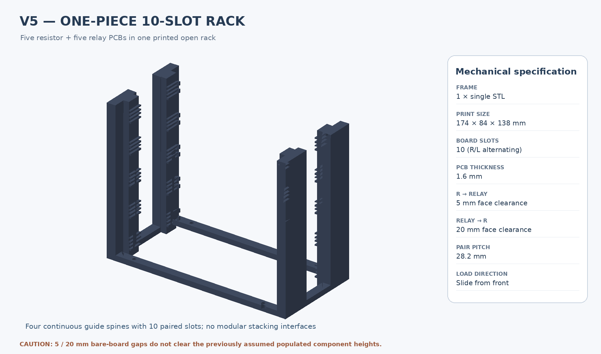
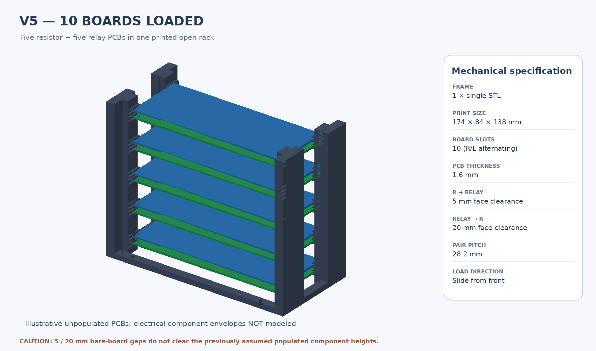
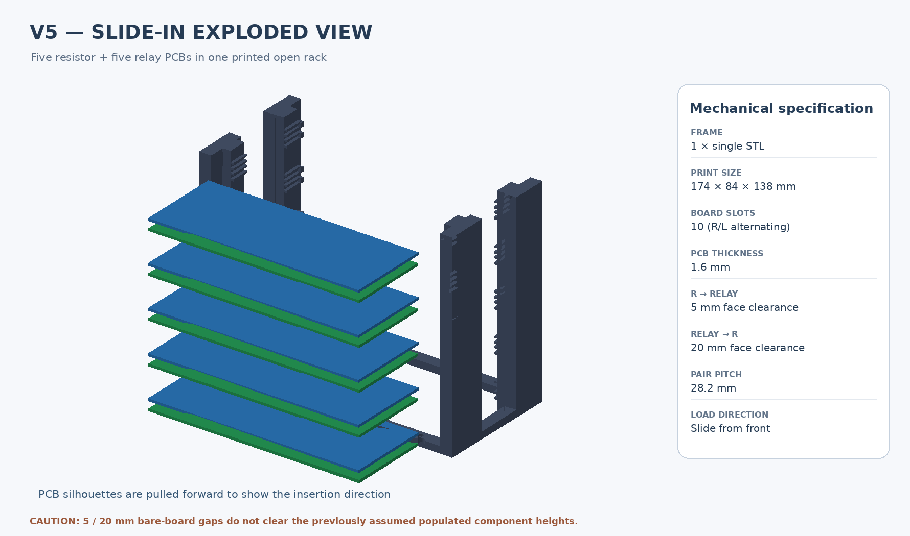

# Enclosure V5 — ONE-PIECE ten-PCB slide-in rack

**Prototype only — populated PCB fit and electrical safety are not qualified.**

This is an **additional V5 variant**. The existing V5 five-section design remains unchanged. Print **one** STL for a complete open rack containing **five resistor and five 8-channel relay PCBs**, sliding in horizontally from the front (-Y). No separate shelf frames, intermodule fasteners or individual spacers are needed.

## Mechanical dimensions

| Parameter | One-piece variant |
| --- | ---: |
| Overall frame | **174 × 84 × 138 mm** |
| Distinct printed parts | **1** |
| Resistor boards | **5** |
| Relay boards | **5** |
| Bare PCB thickness | 1.6 mm |
| Resistor PCB top → relay PCB underside | **5 mm** |
| Relay PCB top → next resistor PCB underside | **20 mm** |
| Pair repeat pitch | **28.2 mm** |
| Board insertion | Front (-Y) |
| Last relay PCB top | Z = 129.0 mm |
| Optional rack-to-bench fixing | 4 × Ø3.4 mm mounting holes |

Bottom-to-top order: R1, L1, R2, L2, R3, L3, R4, L4, R5, L5.

Resistor PCB undersides: Z = 8.0, 36.2, 64.4, 92.6, 120.8 mm.

Relay PCB undersides: Z = 14.6, 42.8, 71.0, 99.2, 127.4 mm.

## Critical compatibility caveat

The **5 mm / 20 mm intervals are between bare PCB faces, not above components**. Assuming resistor components reach 14 mm above the lower PCB and relay components reach 27 mm above the upper PCB, they would protrude **9 mm** and **7 mm**, respectively, into the next PCB's space. These estimated heights were deliberately NOT used to enlarge the clearances. Populated PCBs may physically collide at the requested dimensions.

The resistor PCB dimensions are taken from the real [KiCad design](../../../Resistors-board/Resistors-board.kicad_pcb): 145 × 55 × 1.6 mm, with Ø3.2 mounting holes on 138 × 48 mm centres. Hole positions are not used for this edge-slide carrier.

The **YHQ001 relay PCB envelope is unverified**: the reference model uses 145 × 56 × 1.6 mm. Component placements, terminal wiring, RJ45 access, solder tails and real thermal/electrical clearances are not modeled. Real hardware must be measured before printing for service.

## Print design and assembly

One bottom perimeter ring supports four full-height front/rear upright sections, with a side cable opening between front and rear uprights. Four vertical guide spines carry shallow C-grooves at all ten heights. The unsupported portion of each short guide lip is approximately 2.1 mm. The roof lips and rear stops must be checked in the slicer. The front is open and **does not contain a positive PCB withdrawal latch**; secure the PCBs against sliding out before transporting or using the rack.

Recommended starting point: PETG, 0.4-mm nozzle, 0.2-mm layers, at least four walls, 30–40% infill. Print with the bottom ring flat on a 220 × 220 mm or larger bed, with at least 138 mm clear height. Use a 6–8 mm brim on the tall uprights.

## Files

- [Parametric CadQuery source](create_onepiece.py)
- [Printable STL](onepiece_frame.stl)
- [FreeCAD-compatible STEP](onepiece_frame.step)
- [Ten-PCB reference assembly STEP](ten_pcbs_assembly.step)
- [Exploded slide-in assembly STEP](ten_pcbs_exploded.step)
- [CAD rendering script](render_onepiece.py)
- [Nominal sliding and collision tests](test_fit.py)
- [STL/solid verification](verification.json)
- [Bare-PCB clearance check](fit_check.json)

Rebuild using Python 3.11+ with CadQuery, trimesh, NumPy, Pillow; run the three scripts in this folder in sequence: create_onepiece.py, test_fit.py, render_onepiece.py.

## Qualification

- [x] Single valid OpenCascade solid; watertight connected STL
- [x] All ten empty PCB positions pass non-intersection checks
- [x] Four-point slide path checked for all ten empty PCB models
- [x] Exact 5 mm / 20 mm bare-PCB spacing
- [x] CAD STEP assemblies and model previews
- [ ] Populate real components and verify clearance
- [ ] Measure actual relay PCB outline and connector envelope
- [ ] Test PETG rail fit, sway, board retention and electrical/thermal clearance

**CAD-only fit verification does not establish that the populated hardware will fit or operate safely.**
